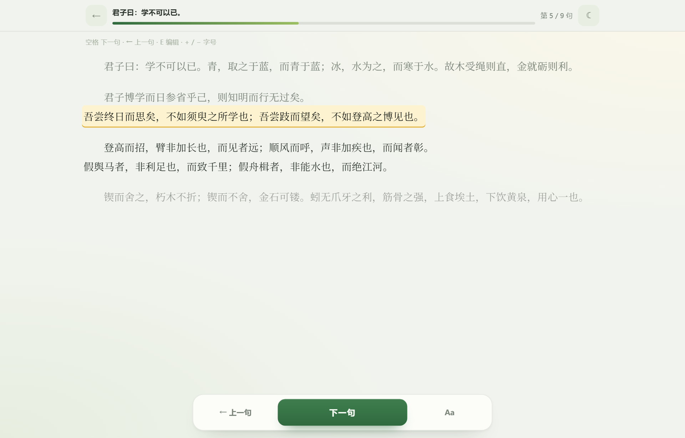
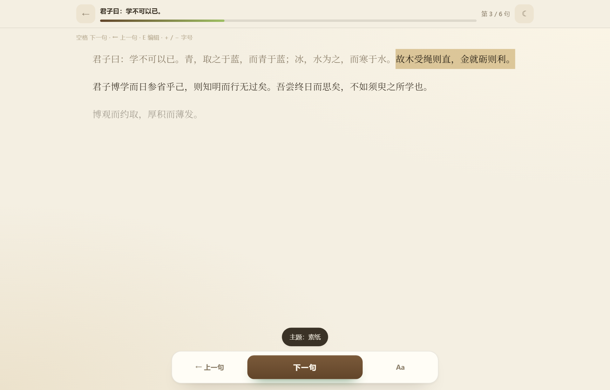
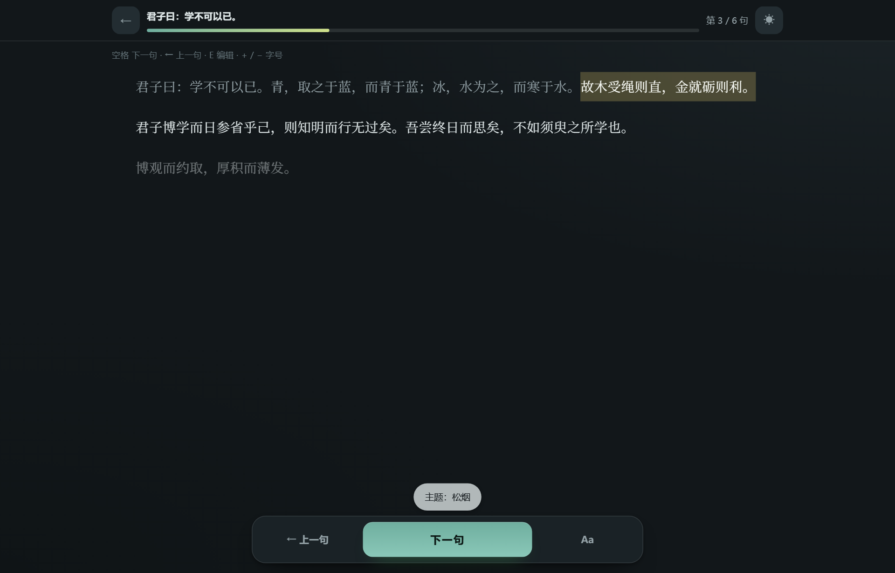
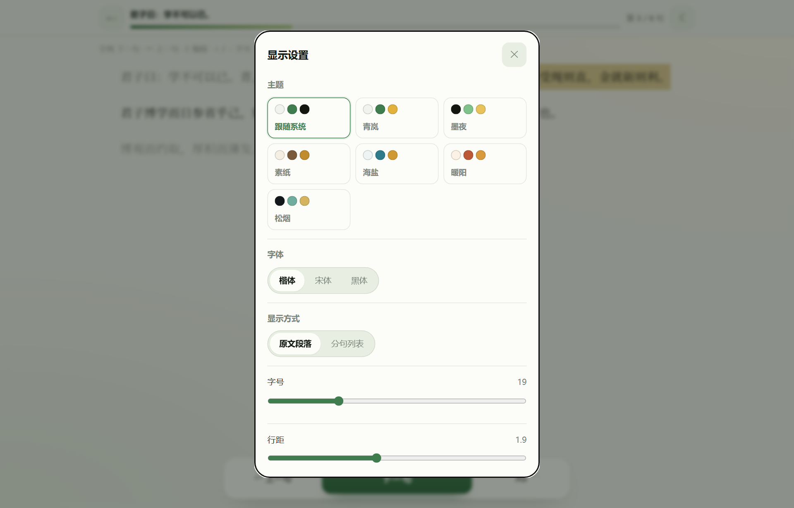
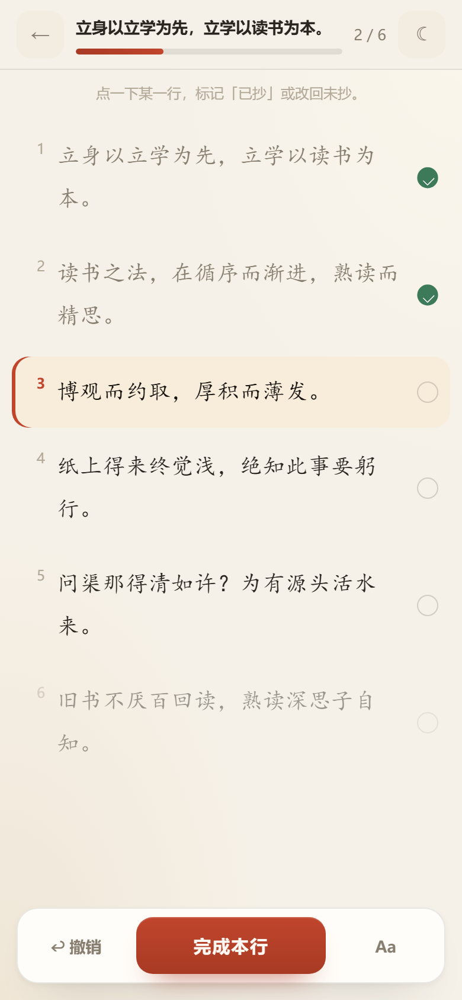
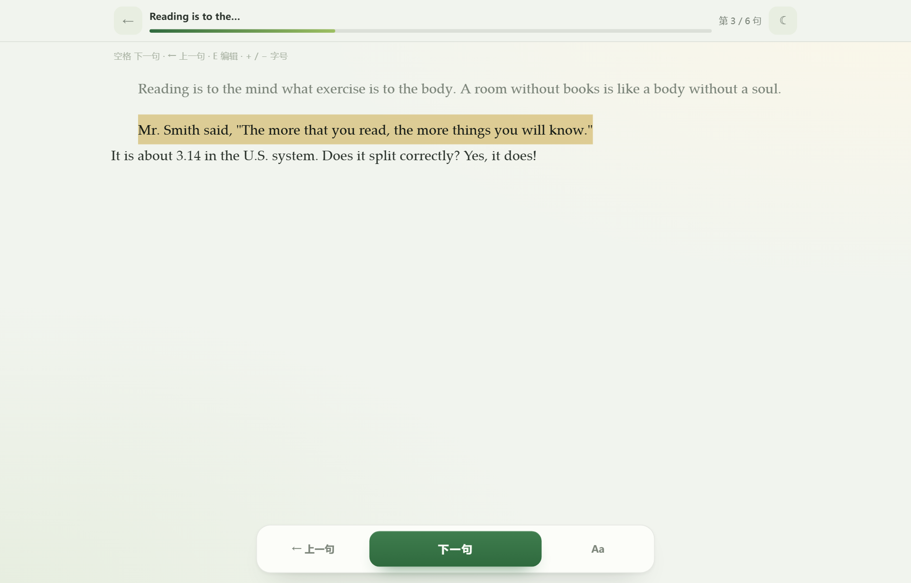
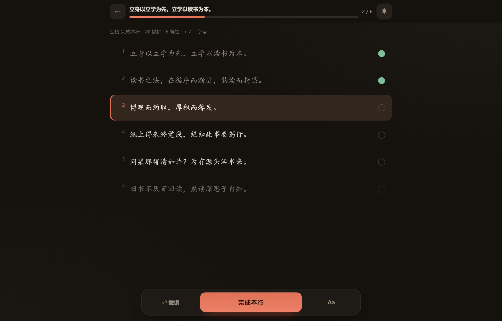
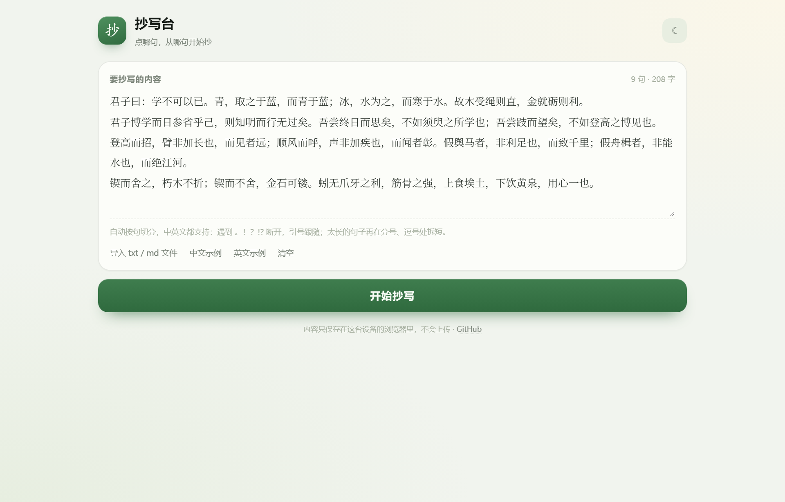

# 抄写台 InkLine

> 点哪句，从哪句开始抄。

把要抄的整段文字粘进来，自动分句、**按原文段落呈现**。抄的时候点任意一句，就从那句开始往下抄：当前句黄色高亮、抄过的句子变灰，进度按顺序推进——不用记录每句抄没抄，也不会写串。

手机、电脑都能用，断网也能用（PWA），内容只存在本机浏览器。

**在线使用：<https://eqmarks.github.io/inkline/>**（GitHub Pages）

## 为什么不会写串

手抄长文最怕「写串」：抬头看屏幕、低头写字，一不留神就跳行、重行。抄写台用**原文段落 + 句级线性进度**解决：

- **保持原文段落**：粘贴的每一段仍是一整段，句子自然连排，不会把文章拆成一行行
- **自动分句**：按中英文句末标点切句，引号、括号跟随前句；太长的中文句子再在分号、逗号处拆短
- **点哪句，从哪句抄**：点一下句子，它变成当前句，前面的句子自动算已抄（变灰）
- **当前句唯一高亮**：像选中文字一样的整块高亮带（浅色为姜黄、深色为暗金），一眼锁定
- **聚焦模式**：离当前段落较远的段落自动变淡
- **线性进度**：顶栏「第 3 / 24 句」+ 进度条；「下一句 / 上一句」、空格、方向键依次推进

没有打勾、没有逐句完成记录——就是一条线，抄到哪算哪。

## 显示方式

设置里可切换：

- **原文段落**（默认）：按原始段落连排，适合抄文章、笔记
- **分句列表**：一句一行，带序号，适合逐句核对
- **段落首行缩进**：可开可关
- **桌面宽度自适应**：宽屏自动展开到 1000px，手机自动收窄

切换显示方式不会丢进度。

## 英文内容

- 英文句子按 <code>. ! ?</code> 切分；缩写（Mr. / Dr. / U.S. / e.g.）、小数（3.14）不会误切
- 西文使用衬线字体（Georgia 等），中文使用楷体 / 宋体 / 黑体，互不干扰
- 英文不拆单词换行，句间自动补空格

## 功能

- **录入**：粘贴整段文字、导入 txt / md、中文示例 / 英文示例
- **智能分句**：中英文句末标点切分；长中文句在 42 字内在分号、逗号处拆短
- **线性抄写**：点任意一句定位；「上一句 / 下一句」或空格、方向键推进
- **进度保存**：内容、位置、设置自动存进浏览器 localStorage，关掉再开点「继续」
- **显示设置**：字号 15–30px、行距、楷体 / 宋体 / 黑体、浅色 / 深色 / 跟随系统、段落缩进、聚焦、自动滚动
- **手机友好**：大触控区域、底部悬浮操作栏、刘海屏安全区适配、无横向滚动
- **离线可用**：Service Worker 缓存，可添加到主屏幕当 App 用
- **可直接打印**：打印时隐藏操作界面，只留抄写内容

## 主题

内置 6 套配色，外加「跟随系统」：

- **青岚**（默认）：绿 / 黄 / 灰，浅色
- **墨夜**：青岚的深色版
- **素纸**：米黄纸 + 墨棕，像旧稿纸
- **海盐**：冷灰蓝 + 青蓝
- **暖阳**：暖米色 + 陶红
- **松烟**：深灰蓝 + 薄荷绿

设置 →「主题」点一下即时生效；顶部圆形按钮可循环切换。深浅主题会自动切换浏览器状态栏颜色。

| 素纸 | 松烟 |
| --- | --- |
|  |  |

主题选择面板：

## 截图

| 桌面 · 原文段落 | 手机 |
| --- | --- |
|  |  |

英文：

深色主题：

录入页：

## 使用方法

1. 打开页面，把要抄的内容整段粘贴进输入框（不用自己分行），或点「导入 txt / md 文件」
2. 点「开始抄写」，自动分句、按段落展示
3. 点任意一句，就从那句开始抄；抄完一句点「下一句」或按空格
4. 关掉页面也没关系，进度自动保存；下次打开点「继续」

## 快捷键

| 按键 | 作用 |
| --- | --- |
| 空格 / Enter / → | 下一句 |
| Backspace / ← | 上一句 |
| E | 回到编辑 |
| + / - | 调整字号 |
| Ctrl / ⌘ + Enter（录入页） | 直接开始抄写 |

## 数据与隐私

所有内容只写在本机浏览器的 <code>localStorage</code>（键名 <code>inkline:v1</code>），不上传、不经过任何服务器。换设备或换浏览器不会同步；清理浏览器数据会一并清空。

## 本地运行

纯静态站点，无需构建、无依赖：

~~~bash
python -m http.server 8000
# 或
npx serve .
~~~

然后打开 http://localhost:8000 。直接双击 <code>index.html</code> 也能用，只是没有离线缓存（Service Worker 需要 http/https）。

## 部署到 GitHub Pages

仓库已按 Pages 组织（全部相对路径 + <code>.nojekyll</code>）：

1. 仓库 **Settings → Pages**
2. **Source** 选 Deploy from a branch，分支 <code>main</code>，目录 <code>/ (root)</code>
3. 访问 https://eqmarks.github.io/inkline/

## 目录结构

~~~
.
├── index.html              # 页面结构
├── assets/
│   ├── app.css             # 样式（段落/列表、绿黄灰、深色、响应式、打印）
│   ├── app.js              # 分句、线性进度、显示方式、中英文、存储
│   └── icon.svg
├── icons/                  # PWA 图标
├── docs/                   # README 截图
├── manifest.webmanifest    # PWA 清单
├── sw.js                   # 离线缓存
└── tools/make_icons.py     # 图标生成脚本
~~~

## License

[MIT](LICENSE)
